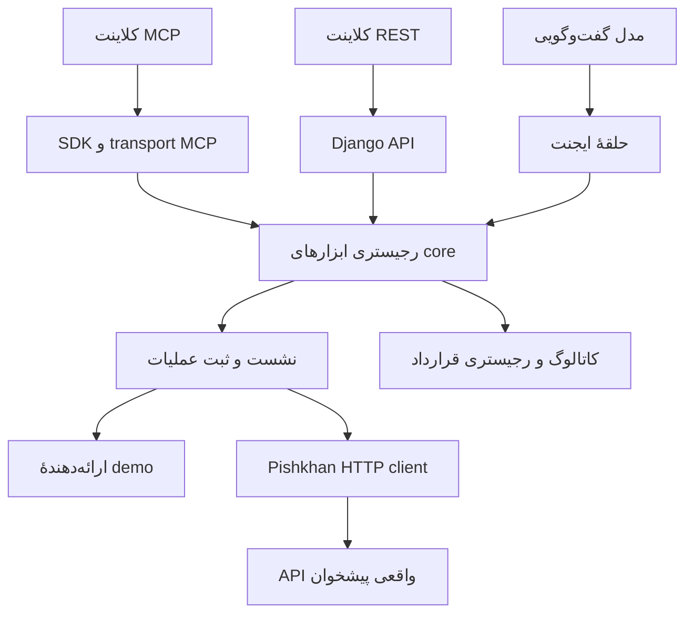

# معماری PishkhanMCP

## هدف و مرز فعلی

پروژه یک هستهٔ مشترک برای اجرای ابزارهای پیشخوان از MCP، API و ایجنت داخلی
دارد. هدف از این ساختار، نگه‌داشتن یک قرارداد اجرایی واحد است: مدل یا کلاینت
انتخاب می‌کند چه ابزاری فراخوانی شود و هسته، نشست و وضعیت عملیات را مدیریت
می‌کند. نتیجهٔ upstream جایگزین با دادهٔ ساختگی نمی‌شود.

نسخهٔ فعلی شامل زیرساخت اجرایی و رجیستری مشاهده‌شدهٔ API است. اجرای سرتاسری
تمام خدمات واقعی هنوز به قراردادهای کامل و آزمون حساب شرکت نیاز دارد.

## مسئولیت بسته‌ها

| بسته | مسئولیت |
|---|---|
| `apps.catalog` | ۵۶ مدخل خدمت عمومی، جست‌وجو، نیازمندی‌ها و منابع |
| `apps.providers.registry` | ۱۵۳ قرارداد endpoint مشاهده‌شده، طرح ورودی، پیش‌نیاز و شواهد منبع |
| `apps.providers.client` | envelope مورد استفادهٔ وب، تشخیص پاسخ upstream و تبدیل خطا |
| `apps.providers.demo` | دادهٔ مشخصاً نمایشی برای سه مسیر منتخب |
| `apps.core.tools` | قرارداد ابزار و dispatch مشترک همهٔ رابط‌ها |
| `apps.core.operations` | نشست، ورود، استعلام، پیشنهاد هزینه، ثبت درخواست و پیگیری |
| `apps.mcpserver` | Streamable HTTP، stdio، JSON Schema و تبدیل نتیجه به MCP |
| `apps.agent` | Chat Completions، انتخاب ابزار، اجرای مرحله‌ای و ذخیرهٔ گفت‌وگو |

کاتالوگ محصول و رجیستری API دو مفهوم جدا هستند. یک خدمت می‌تواند چند endpoint
داشته باشد؛ برخی endpointها نیز مربوط به حساب یا عملکرد مشترک‌اند. تعداد
endpointها معیار تکمیل فرایندهای محصول نیست.

## قرارداد ابزارها

`list_tools()` فهرستی از نام، شرح، `inputSchema` و annotationها می‌دهد.
`call_tool(name, arguments)` یک شیء JSON نتیجه برمی‌گرداند. خطاهای دامنه با
`ok: false` و شیء `error` گزارش می‌شوند.

MCP و ایجنت داخلی قبل از dispatch طرح ورودی را بررسی می‌کنند. خود core نیز
اعتبارسنجی انجام می‌دهد تا درخواست REST همان قواعد را داشته باشد. مدل از
ورودی ابزار نمی‌تواند URL دلخواه برای HTTP client انتخاب کند؛ endpoint از
رجیستری شناخته‌شده برداشته می‌شود.

رجیستری منبع در `apps/providers/data/pishkhan_actions.json` شامل آدرس منبع،
تاریخ بررسی و اطلاعات کامل‌بودن schema است. `source_verified` یعنی endpoint
در منبع عمومی دیده شده؛ این مقدار به معنی `authenticated_live_validated`
نیست. schemaهای `partial` فقط فیلدهای مشاهده‌شده را توصیف می‌کنند و قرارداد
کامل تجاری را جایگزین نمی‌کنند.

## ورود و نشست

`AccountSession` یک شناسهٔ مستقل برای مصرف‌کننده ایجاد می‌کند و mode، وضعیت
ورود و نشست upstream را نگه می‌دارد. ابزارها به‌جای دریافت توکن در هر بار، از
`session_id` استفاده می‌کنند.

در demo، ورود و OTP شبیه‌سازی می‌شوند. در live، ابتدا `DeviceRegister` برای
ساخت نشست دستگاه فراخوانی می‌شود. سپس `LoginByOTP` یا
`LoginByUserCredential` اجرا می‌شوند. تبدیل رمز عبور با رفتار مشاهده‌شدهٔ
فرانت‌اند upstream منطبق شده است؛ این تبدیل یک نیاز قرارداد wire است.

اگر bootstrap با خطا مواجه شود، نشست محلی ایجادشده می‌ماند و خروجی توضیح
می‌دهد چه تنظیمی لازم است. `p24_import_session` مسیر استفاده از یک نشست فعال
متعلق به کاربر است. اعتبار upstream آن در فراخوانی بعدی مشخص می‌شود.

در این نسخه OAuth برای خود MCP وجود ندارد. کلید اختیاری `P24_ACCESS_KEY`
یک کنترل دسترسی سادهٔ مشترک برای نصب توسعه است؛ این کلید جای نشست پیشخوان
را نمی‌گیرد.

## عملیات و تکرار درخواست

پیش از انجام اثر بیرونی، یک رکورد `Operation` ثبت و commit می‌شود. ترکیب
نشست و `idempotency_key` در پایگاه داده یکتا است. همان کلید با همان ورودی،
رکورد قبلی را برمی‌گرداند و با ورودی متفاوت خطای تعارض می‌دهد.

| وضعیت | معنا |
|---|---|
| `running` | درخواست ثبت شده و نتیجهٔ نهایی هنوز ثبت نشده است |
| `requires_user_action` | نتیجهٔ اولیه نیازمند اقدام کاربر است |
| `completed` | اجرای مرحلهٔ ثبت‌شده با پاسخ قابل پردازش تمام شده است |
| `failed` | پاسخ ناموفق مشخص دریافت شده است |
| `unknown` | نتیجهٔ اثر بیرونی با قطع ارتباط یا خطا مشخص نیست |

`completed` برای یک مرحله، به‌تنهایی به معنی تسویهٔ کل فرایند مالی نیست.
وضعیت صورتحساب یا پرداخت باید از ابزار مرتبط خوانده شود. در timeout، POST
به‌صورت خودکار دوباره ارسال نمی‌شود. جلوگیری از تکرار محلی، تضمین قطعی
exactly-once در تأمین‌کننده نیست؛ قرارداد upstream و تطبیق وضعیت برای هر
جریان واقعی باید آزموده شوند.

`Quote` ورودی استعلام، مبلغ، واحد پول، زمان انقضا و در live کلید خرید را
نگه می‌دارد. اجرای دوبارهٔ همان quote به همان هویت عملیات محلی متصل می‌شود.
مبالغ نمایشی در demo به‌وضوح از برداشت واقعی تفکیک شده‌اند.

## جریان استعلام و پرداخت

در قرارداد عمومی مشاهده‌شده، برخی استعلام‌ها ابتدا `InvoiceRegister` را با
نام خدمت و ورودی آن فراخوانی می‌کنند. پاسخ می‌تواند شامل پیش‌نیازها، مبلغ،
کانال پرداخت و `PurchaseKey` باشد. ابزارهای core این مراحل را جدا کرده‌اند
تا ایجنت بتواند ادامهٔ عملیات را از نتیجهٔ مرحلهٔ قبل استخراج کند.

`P24_PAYMENT_CALLBACK` باید callback معتبر همان قرارداد باشد. مقدار خالی
به خطای صریح منجر می‌شود. رجوع مرورگر یا وجود redirect، تأیید پرداخت محسوب
نمی‌شود؛ `p24_invoice_status` برای پیگیری پاسخ upstream وجود دارد.

## ASGI و MCP

`config.asgi.application` از factory موجود در `apps.mcpserver.server` استفاده
می‌کند. برنامهٔ Starlette تولیدشده توسط SDK در مسیر `/mcp` قرار می‌گیرد و
سایر مسیرها به Django هدایت می‌شوند. lifecycle خود SDK در همان برنامهٔ اصلی
اجرا می‌شود؛ mount کردن بدون lifespan باعث خطای runtime خواهد شد.

HTTP به‌صورت stateless و با پاسخ JSON تنظیم شده است. استمرار حساب و عملیات
در پایگاه دادهٔ Django نگه داشته می‌شود و وابسته به session یک transport
نیست. stdio از همان رجیستری ابزار و مدیریت عملیات استفاده می‌کند.

## ایجنت داخلی

ایجنت از API سازگار با Chat Completions استفاده می‌کند و schema ابزارها را
به مدل می‌دهد. `session_id` از گفت‌وگوی جاری گرفته می‌شود و کلید درخواست
برای فراخوانی‌های دارای اثر تولید می‌شود. پاسخ ابزار به مدل برگردانده می‌شود
تا نوبت بعدی را تعیین کند. تعداد مراحل محدود و trace فراخوانی‌ها در خروجی
قابل بررسی است.

بدون تنظیم مدل، خطای مشخص داده می‌شود؛ هیچ مسیری با تطبیق چند کلمه وانمود
نمی‌کند یک مدل یا استعلام واقعی اجرا شده است. متن گفتگو و trace پیش از
ذخیره یا نمایش از مقادیر credential شناخته‌شده پاک‌سازی می‌شوند.

## توسعهٔ پوشش

برای اضافه‌کردن یک جریان واقعی:

1. endpoint و envelope را از قرارداد معتبر شرکت ثبت کنید.
2. فیلدهای ورودی و پیش‌نیازها را کامل کنید و schema را از `partial` ارتقا دهید.
3. آن را به خدمت کاتالوگ مربوط متصل کنید.
4. رفتار خطا، هزینه، تکرار و پیگیری را با نمونهٔ پاسخ معتبر آزمون کنید.
5. فرایند کامل را با حساب آزمایشی اجرا و شواهد بدون credential ثبت کنید.
6. تنها سپس وضعیت پوشش همان فرایند را به آزموده‌شده تغییر دهید.

اجرای همهٔ endpointها با ورودی حدسی، مسیر توسعهٔ پوشش نیست. نقشهٔ خدمات
باید به فرایندهای کامل و نتایج قابل تأیید متصل شود.
